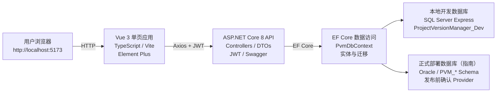

# Project Version Manager 项目架构及开发指南

> Vue 3 · ASP.NET Core 8 · Entity Framework Core

| **文档版本**     | V1.0                                         |
|------------------|----------------------------------------------|
| **生成日期**     | 2026-08-06                                   |
| **本地环境**     | SQL Server Express + Vue 3 + ASP.NET Core 8  |
| **正式部署参考** | Oracle + IIS + ASP.NET Core 8 Hosting Bundle |
| **适用范围**     | 开发、联调、调试、构建、测试、部署与维护     |

依据 README.md、ARCHITECTURE_AND_DEBUGGING.md、
DATABASE_CONNECTION_GUIDE.md、DEPLOYMENT_GUIDE.md 整理

# 文档说明
本指南将四份现有材料合并为一套统一的项目说明，既保留当前代码与文档中的目录、端口、配置键和运行命令，也对本地 SQL Server 与正式 Oracle 指南之间的差异进行显式标注。

> **重要：数据库环境存在版本差异**
>
> README 与数据库连接指南明确说明当前本地开发使用 SQL Server Express、连接键为 `DefaultConnection`、代码调用 `UseSqlServer`；原架构与部署指南仍包含 Oracle、`ConnectionStrings__Oracle` 和 Oracle Provider 的描述。因此，本指南采用“双环境视图”，但不假定同一份当前代码能够自动在两个 Provider 之间切换。正式发布前必须检查实际发布分支的 Program.cs、NuGet Provider 和配置键。

# 目录

- [1. 项目概述与文档结论](#1-项目概述与文档结论)
- [2. 总体架构](#2-总体架构)
- [3. 目录结构与职责](#3-目录结构与职责)
- [4. 技术栈与业务机制](#4-技术栈与业务机制)
- [5. 环境划分与配置边界](#5-环境划分与配置边界)
- [6. 本地开发环境搭建](#6-本地开发环境搭建)
- [7. 配置管理指南](#7-配置管理指南)
- [8. 前端开发指南](#8-前端开发指南)
- [9. 后端开发指南](#9-后端开发指南)
- [10. 数据库开发与变更](#10-数据库开发与变更)
- [11. 联调与断点调试](#11-联调与断点调试)
- [12. 构建、测试与发布包](#12-构建测试与发布包)
- [13. 正式部署指南](#13-正式部署指南)
- [14. 运维与版本变更流程](#14-运维与版本变更流程)
- [15. 安全与发布检查清单](#15-安全与发布检查清单)
- [16. 常见问题排查](#16-常见问题排查)
- [附录 A. 常用命令速查](#附录-a-常用命令速查)
- [附录 B. 资料来源与待确认项](#附录-b-资料来源与待确认项)

# 1. 项目概述与文档结论
Project Version Manager 是一个面向内部团队的项目版本管理 Web 系统。系统采用前后端分离模式：Vue 3 负责业务界面，ASP.NET Core 8 Web API 提供接口，Entity Framework Core 负责数据库访问。

| **维度**   | **当前结论**                             | **说明**                                                   |
|------------|------------------------------------------|------------------------------------------------------------|
| 应用形态   | 前后端分离的单页 Web 应用                | 浏览器加载 Vue UI，后端主要返回 JSON。                     |
| 前端       | Vue 3 + TypeScript + Vite + Element Plus | 开发端口固定为 5173，Axios 访问 API。                      |
| 后端       | ASP.NET Core 8 Web API                   | 默认调试端口为 5098，Swagger 为接口调试页面。              |
| 本地数据库 | SQL Server Express                       | 数据库名 ProjectVersionManager_Dev，Windows 身份验证。     |
| 正式数据库 | Oracle（现有部署指南）                   | 必须确认发布分支已恢复/保留 Oracle Provider 与正确配置键。 |
| 认证授权   | JWT Bearer + 角色/权限控制               | 包含 ADMIN 管理员角色与用户权限表。                        |
| 部署方式   | Windows Server + IIS                     | API 使用 .NET 8 Hosting Bundle，前端为静态 dist。          |

## 1.1 当前业务能力
- **身份认证：**JWT 登录认证、管理员角色和权限分配。
- **版本管理：**分页、组合筛选、新增、修改、删除和批量操作。
- **数据安全：**软删除、回收站恢复、RowVersion 乐观并发控制。
- **审计能力：**新增、修改、删除等操作生成操作日志。
- **数据交换：**Excel 导出；部署验收清单还要求验证批量导入和模板下载。
- **接口治理：**统一 API 返回格式、统一异常处理中间件和 Swagger/OpenAPI。

## 1.2 本指南采用的环境模型
本地开发以 README 与 SQL Server 连接指南为准；正式部署步骤以现有 Oracle 部署指南为参考。两者通过配置、数据库脚本、管理员初始化方式和发布流程进行隔离。

```mermaid
flowchart LR
    subgraph DEV[本地开发]
        D1[数据库：SQL Server Express]
        D2[连接键：DefaultConnection]
        D3[Provider：UseSqlServer]
        D4[配置：appsettings.Development.json]
        D5[结构：SqlServer_Initial.sql / EF Migration]
        D6[管理员：DevelopmentAdmin 可按条件初始化]
        D7[前端：http://localhost:5173]
        D8[API：http://localhost:5098/api]
    end

    subgraph PROD[正式生产]
        P1[数据库：Oracle（部署指南约定）]
        P2[连接键：ConnectionStrings__Oracle]
        P3[Provider：发布分支必须确认 Oracle Provider]
        P4[配置：IIS 环境变量 / 安全配置源]
        P5[结构：DBA 审核并执行 Oracle SQL]
        P6[管理员：不得启用 DevelopmentAdmin]
        P7[前端：IIS 静态站点 + HTTPS]
        P8[API：IIS + .NET 8 Hosting Bundle]
    end

    DEV -. 配置、密钥和数据库变更方式必须隔离 .- PROD
```



> **发布门禁：**确认当前 API 代码确实支持目标数据库 Provider 与对应连接键。

图 1 本地开发与正式部署的配置边界

# 2. 总体架构
系统请求链路为：浏览器访问 Vue 单页应用，Vue 通过 Axios 携带 JWT 调用 ASP.NET Core API，API 通过 `PvmDbContext` 和相应 EF Core Provider 访问数据库。



图 2 Project Version Manager 逻辑架构

## 2.1 前后端边界
| **层级**            | **主要职责**                                       | **不应承担的职责**                                                     |
|---------------------|----------------------------------------------------|------------------------------------------------------------------------|
| Vue 前端            | 页面渲染、表单校验、状态展示、接口调用、令牌保存   | 不得保存数据库账号密码；不得直接连接数据库；不承担服务端权限最终判定。 |
| ASP.NET Core API    | 认证授权、业务规则、数据验证、日志审计、数据库访问 | 不得把生产密钥写死在代码或提交到仓库。                                 |
| EF Core / DbContext | 实体映射、查询、事务与并发控制                     | 不得绕过业务权限直接暴露任意数据库操作。                               |
| 数据库              | 持久化、约束、索引、唯一性保护                     | 生产库结构变更不得依赖运行时自动建表。                                 |

## 2.2 当前后端分层特点
现有 API 属于相对简单的分层结构，Controller 会直接使用 `PvmDbContext`；当前没有严格拆分 Repository、Application Service 和 Domain 层。因此，新增复杂业务时应优先把可复用规则放入 Services，避免 Controller 持续膨胀。

```text
Controllers
↓
DTO / Entity
↓
PvmDbContext
↓
SQL Server（本地）或 Oracle（正式发布分支确认后）
```

> **演进建议**
>
> 当项目出现多数据库适配、复杂审批流程或大量跨表规则时，可再引入 Application Service / Repository 抽象；当前阶段无需为形式上的 Clean Architecture 过度拆分。

# 3. 目录结构与职责
```text
ProjectVersionManager
├─ src
│ ├─ ProjectVersionManager.Api # ASP.NET Core 后端
│ └─ ProjectVersionManager.Web # Vue 3 前端
├─ tests
│ └─ ProjectVersionManager.Tests # 后端单元测试
├─ database
│ ├─ SqlServer_Initial.sql # 当前本地 SQL Server 初始脚本
│ └─ OracleBackup/ # 原 Oracle 脚本备份/正式参考
├─ ProjectVersionManager.sln # Visual Studio 解决方案
└─ ProjectVersionManager.slnLaunch # API 调试启动配置（若存在）
```

## 3.1 前端主要文件
| **文件**      | **职责**                                       |
|---------------|------------------------------------------------|
| index.html    | HTML 入口，提供 \#app 挂载节点。               |
| src/main.ts   | 创建 Vue 应用并加载 Element Plus。             |
| src/App.vue   | 登录页和主要业务界面。                         |
| src/api.ts    | Axios 实例、`VITE_API_BASE_URL` 和后端接口封装。 |
| src/types.ts  | TypeScript 数据类型定义。                      |
| src/style.css | 全局样式、主题、布局和响应式规则。             |
| package.json  | 前端依赖与 npm scripts。                       |

## 3.2 后端主要目录
| **目录**       | **职责**                                | **开发注意事项**                               |
|----------------|-----------------------------------------|------------------------------------------------|
| Controllers    | HTTP API 入口                           | 只处理请求编排、权限属性和响应；复杂规则下沉。 |
| Dtos           | 请求与响应模型                          | 避免直接把数据库实体作为所有外部契约。         |
| Entities       | 数据库实体                              | 字段变更需同步数据库脚本/迁移。                |
| Data           | `PvmDbContext`、Provider 配置、Migrations | 数据库切换首先检查此处与 Program.cs。          |
| Services       | JWT、初始化及可复用业务服务             | 适合放认证、导入、校验等逻辑。                 |
| Infrastructure | 异常处理、映射和公共基础设施            | 统一异常与跨切面逻辑。                         |

# 4. 技术栈与业务机制
## 4.1 前端技术
| **技术**     | **用途**                                 |
|--------------|------------------------------------------|
| Vue 3        | 构建单页应用和组合式前端逻辑。           |
| TypeScript   | 静态类型检查，降低接口字段错误。         |
| Vite         | 开发服务器、热更新和生产构建。           |
| Element Plus | 表格、表单、分页、抽屉、弹窗等 UI 组件。 |
| Axios        | 调用 API 并附带 JWT。                    |
| CSS          | 主题、布局和响应式界面。                 |

## 4.2 后端技术
| **技术**                      | **用途**                                               |
|-------------------------------|--------------------------------------------------------|
| .NET 8 / ASP.NET Core Web API | 承载 API、依赖注入、中间件和配置系统。                 |
| Entity Framework Core 8       | 对象关系映射和数据访问。                               |
| SQL Server Provider           | 当前本地开发数据库 Provider。                          |
| Oracle Provider               | 原架构/正式部署指南所要求的生产 Provider；发布前核验。 |
| JWT Bearer                    | 无状态身份认证。                                       |
| Swagger/OpenAPI               | 接口文档与手工调试。                                   |
| ClosedXML                     | Excel 导出。                                           |
| xUnit + Coverlet              | 单元测试和覆盖率收集。                                 |

## 4.3 数据与业务机制
- 项目版本使用分页与组合条件查询，避免一次加载全部数据。
- 删除以软删除为主，并提供回收站恢复；管理员可执行真实删除。
- RowVersion 用于乐观并发控制，防止多人同时修改覆盖。
- 有效项目版本通过“程序组 + 程序名 + 程序版本 + IS_DELETED=0”进行重复保护。
- 操作日志用于记录关键增删改行为和操作者。

# 5. 环境划分与配置边界
## 5.1 环境矩阵
| **配置项**             | **本地开发**                            | **正式部署参考**                                                |
|------------------------|-----------------------------------------|-----------------------------------------------------------------|
| ASPNETCORE_ENVIRONMENT | Development                             | Production                                                      |
| 前端地址               | http://localhost:5173                   | https://pvm.company.local（示例）                               |
| API 基址               | http://localhost:5098/api               | https://pvm-api.company.local/api（示例）                       |
| 数据库                 | SQL Server Express                      | Oracle（现有部署指南）                                          |
| 连接配置键             | `ConnectionStrings:DefaultConnection`     | ConnectionStrings:Oracle / 环境变量 ConnectionStrings\_\_Oracle |
| EF Provider            | `UseSqlServer`                            | `UseOracle`（发布分支必须确认）                                   |
| 数据库结构变更         | EF Migration 或 SqlServer_Initial.sql   | DBA 审核 SQL，维护窗口执行                                      |
| 开发管理员             | 可按 `DevelopmentAdmin` 条件初始化        | 必须关闭，不自动创建                                            |
| 密钥保存               | 本地配置/User Secrets，禁止提交真实密码 | IIS 环境变量或公司密钥管理方案                                  |

## 5.2 发布前数据库兼容性门禁
> **1.** 打开发布分支的 Program.cs，确认读取的连接键与服务器配置一致。
>
> **2.** 确认已安装目标数据库对应的 EF Core Provider NuGet 包。
>
> **3.** 确认 AddDbContext 中实际调用 `UseSqlServer` 或 `UseOracle`，而不是仅修改连接字符串。
>
> **4.** 确认迁移/SQL 脚本与目标数据库方言一致，不能把 SQL Server 脚本直接用于 Oracle。
>
> **5.** 在测试环境执行登录、列表查询、新增、重复校验、软删除、恢复和日志验证。

> **不能仅修改连接字符串完成数据库切换**
>
> SQL Server 与 Oracle 需要不同 Provider、配置键和数据库脚本。现有资料没有证明当前同一分支已经实现运行时自动切换，因此必须按发布分支代码核验。

# 6. 本地开发环境搭建
## 6.1 前置软件
- Windows 10/11 或 Windows Server 开发环境。
- Visual Studio 2022（安装 ASP.NET 和 Web 开发工作负载）或 .NET 8 SDK。
- Node.js 与 npm。
- SQL Server Express，实例名默认 .\SQLEXPRESS。
- 可选：SQL Server Management Studio，用于检查表和数据。

## 6.2 初始化本地数据库
当前本地数据库使用 Windows 身份验证，默认连接字符串如下：

```text
Server=.\SQLEXPRESS;Database=ProjectVersionManager_Dev;Trusted_Connection=True;TrustServerCertificate=True;MultipleActiveResultSets=True
```

可选择以下任一方式创建或重建本地结构：

- **方式 A：**审查并执行 database/SqlServer_Initial.sql。
- **方式 B：**使用 EF Core Migration 更新数据库。

```powershell
dotnet ef database update `
--project .\src\ProjectVersionManager.Api `
--startup-project .\src\ProjectVersionManager.Api `
--context PvmDbContext
```

## 6.3 启动后端
```powershell
dotnet restore .\ProjectVersionManager.sln
dotnet run --project .\src\ProjectVersionManager.Api
```

也可以使用 Visual Studio 打开 `ProjectVersionManager.sln`，将 `ProjectVersionManager.Api` 设置为启动项目，选择 http 或 https 项目配置后按 F5。

| **检查项** | **默认地址**                  |
|------------|-------------------------------|
| Swagger    | http://localhost:5098/swagger |
| 健康检查   | http://localhost:5098/health  |
| API 基址   | http://localhost:5098/api     |

## 6.4 启动前端
```powershell
cd .\src\ProjectVersionManager.Web
npm install
npm run dev -- --port 5173 --strictPort
```

浏览器访问 http://localhost:5173。使用 --strictPort 可防止 5173 被占用时 Vite 自动切换到 5174，从而避免后端 CORS 与实际前端地址不一致。

> **npm install 的执行时机**
>
> 通常只需首次运行，或 package.json / lock 文件变化后再次执行。日常修改 Vue 和 CSS 由 Vite 热更新，不需要重复 npm install。

# 7. 配置管理指南
## 7.1 本地数据库配置
SQL Server 本地配置位于 `src/ProjectVersionManager.Api/appsettings.Development.json`：

```json
{
  "ConnectionStrings": {
    "DefaultConnection": "Server=.\\SQLEXPRESS;Database=ProjectVersionManager_Dev;Trusted_Connection=True;TrustServerCertificate=True;MultipleActiveResultSets=True"
  }
}
```

Program.cs 从 `ConnectionStrings:DefaultConnection` 读取并调用 `UseSqlServer`：

```csharp
var connectionString = builder.Configuration.GetConnectionString("DefaultConnection");
builder.Services.AddDbContext<PvmDbContext>(options =>
    options.UseSqlServer(connectionString));
```

## 7.2 前端 API 地址
前端默认 API 地址由 `src/ProjectVersionManager.Web/src/api.ts` 或环境变量 `VITE_API_BASE_URL` 提供。开发环境可创建 .env.development：

```dotenv
VITE_API_BASE_URL=http://localhost:5098/api
```

- 环境文件名必须正确，不能误写成 .env.development.example 后仍期待 Vite 自动加载。
- 修改 .env 后需要停止并重新启动 Vite。
- `VITE_API_BASE_URL` 应包含 /api，因为 Controller 路由按项目配置位于该前缀下。

## 7.3 CORS 配置
```json
{
  "Cors": {
    "AllowedOrigins": [
      "http://localhost:5173"
    ]
  }
}
```

CORS 来源必须与浏览器地址完全一致，包括协议、域名和端口。正式环境只填写前端来源，例如 https://pvm.company.local，不要填写 /api。

## 7.4 JWT 与敏感信息
- 生产环境必须替换默认 JWT 密钥，并使用至少 32 位的随机强密钥。
- 真实数据库密码、JWT 密钥不得写入 Git、Markdown 文档或 Vue .env。
- Vue 环境变量会被打包进前端静态文件，因此只能放公开的 API 地址，不能放数据库或服务端密钥。
- 本地可使用 User Secrets 或受控的 Development 配置；生产使用 IIS 环境变量或公司密钥管理方案。

# 8. 前端开发指南
## 8.1 开发入口与运行方式
正式前端目录为 `src/ProjectVersionManager.Web`。Visual Studio 解决方案默认只包含 API 和测试项目，Vue 不属于 .csproj，因此按 F5 后只打开 Swagger 是正常现象。Vue UI 必须通过 npm run dev 单独启动。

## 8.2 推荐开发约定
- **接口集中管理：**所有 Axios 请求集中在 api.ts 或按业务拆分的 api 模块，避免在组件中散落完整 URL。
- **类型同步：**DTO 字段变化时同步更新 types.ts，利用 TypeScript 提前发现接口不一致。
- **令牌处理：**JWT 登录状态按现有项目使用 SessionStorage；退出登录时清理令牌。
- **错误展示：**统一处理 401、403、409 和 500；409 可用于并发或重复数据提示。
- **组件职责：**App.vue 当前承载较多业务时，可逐步拆分版本列表、编辑表单、项目设置、人员管理和日志组件。
- **配置隔离：**开发、测试、生产使用不同 `VITE_API_BASE_URL`，构建前确认目标环境。

## 8.3 调试方式
> **1.** 运行 npm run dev -- --port 5173 --strictPort。
>
> **2.** 浏览器打开 http://localhost:5173 并按 F12。
>
> **3.** 在 Sources 中找到 App.vue、api.ts 或 TypeScript 源文件并设置断点。
>
> **4.** 在 Network 中检查请求 URL、方法、Authorization、状态码和响应体。
>
> **5.** 遇到界面未更新时，先检查 Vite 终端的编译错误，再手动刷新。

## 8.4 生产构建
```powershell
cd .\src\ProjectVersionManager.Web
npm ci
npm run build
```

构建结果位于 `src/ProjectVersionManager.Web/dist`。npm ci 更适合正式构建，可严格按照 lock 文件安装依赖。

# 9. 后端开发指南
## 9.1 Controller 开发
- 使用 DTO 接收请求，进行模型验证，不直接信任前端传值。
- 对管理接口增加角色或权限授权属性；前端隐藏按钮不能代替后端授权。
- 查询接口保持分页，避免无条件返回全表。
- 新增/修改/删除成功后写入操作日志。
- 捕获并发冲突和唯一性冲突，转换为清晰的业务响应。

## 9.2 Entity 与 DbContext
- 实体字段调整后，同步更新 DbContext 映射、DTO、前端 types.ts 和数据库脚本/迁移。
- RowVersion 字段用于乐观锁，更新时必须携带原版本值并处理冲突。
- 软删除查询应默认过滤 IS_DELETED=1 的记录；回收站接口显式查询已删除数据。
- 数据库唯一索引仍是最终重复保护，API 校验用于提供更友好的提示。

## 9.3 统一异常处理
Infrastructure/ExceptionHandlingMiddleware.cs 是常用断点位置。新增异常类型时，应保持统一响应格式，不在生产响应中返回堆栈和数据库敏感信息。

## 9.4 开发管理员
`DevelopmentAdmin:Enabled` 仅用于 Development 环境。API 仅在数据库不存在 admin 用户时创建账号，密码通过 ASP.NET Core PasswordHasher 保存，不应向 PASSWORD_HASH 写入明文。

# 10. 数据库开发与变更
## 10.1 核心数据表
| **表名**            | **用途（依据现有资料）**                        |
|---------------------|-------------------------------------------------|
| PVM_USER            | 系统用户和登录信息。                            |
| PVM_PROJECT_VERSION | 项目/程序版本主数据。                           |
| PVM_OPERATION_LOG   | 操作审计日志。                                  |
| PVM_PROJECT_OPTION  | 项目设置、下拉选项等配置数据。                  |
| PVM_USER_PERMISSION | 用户权限分配；SQL Server 指南说明存在级联外键。 |

## 10.2 SQL Server 本地结构
database/SqlServer_Initial.sql 包含主键、唯一索引、查询索引、有效版本唯一索引、状态/权限/选项类型/操作类型检查约束、用户权限级联外键、软删除、乐观锁和日期默认值。迁移源码位于 `src/ProjectVersionManager.Api/Data/Migrations/SqlServer`。

## 10.3 Oracle 正式部署结构
现有部署指南要求由 DBA 创建 Oracle 用户/Schema，并执行完整 PVM 脚本。当前 README 说明原 Oracle 脚本已移动至 database/OracleBackup/PVM_DBA_COMPLETE.sql；而部署指南仍引用 database/PVM_DBA_COMPLETE.sql。发布前需要以仓库实际路径为准并由 DBA 审核。

## 10.4 有效版本重复规则
```text
PROGRAM_GROUP + PROGRAM_NAME + PROGRAM_VERSION
且 IS_DELETED = 0
```

已有生产数据创建唯一索引前，应先备份并检查重复有效记录。Oracle DDL 会隐式提交，不能依赖普通 ROLLBACK 撤销建表或约束变更。

## 10.5 数据库变更标准流程
> **1.** 修改实体、DTO 和数据库设计。
>
> **2.** 更新完整结构基线脚本，作为新环境安装和结构核对依据。
>
> **3.** 为已上线数据库单独准备增量变更 SQL。
>
> **4.** DBA 或数据库负责人审核并备份。
>
> **5.** 在维护窗口执行增量 SQL。
>
> **6.** 发布与结构匹配的 API 版本。
>
> **7.** 验证约束、接口、重复保护、并发控制和操作日志。

# 11. 联调与断点调试
## 11.1 标准联调顺序
> **1.** 启动 SQL Server Express 并确认 ProjectVersionManager_Dev 可访问。
>
> **2.** 启动 API，先访问 /swagger 和 /health。
>
> **3.** 启动 Vue，确认固定在 5173。
>
> **4.** 浏览器登录，检查 Network 中请求是否指向 http://localhost:5098/api。
>
> **5.** 执行查询、新增、修改、删除、恢复等业务操作。
>
> **6.** 在 Visual Studio 中观察断点、异常和 EF Core 日志。

## 11.2 后端常用断点
```text
Controllers/AuthController.cs
Controllers/ProjectVersionsController.cs
Controllers/OperationLogsController.cs
Infrastructure/ExceptionHandlingMiddleware.cs
```

## 11.3 接口失败的定位顺序
| **现象**               | **优先检查**                                                        |
|------------------------|---------------------------------------------------------------------|
| 页面打不开             | Vite 是否运行、端口是否为 5173、浏览器地址是否正确。                |
| 页面可开但请求 404     | `VITE_API_BASE_URL`、/api 前缀、API 实际端口、Controller 路由。       |
| CORS 错误              | AllowedOrigins 是否与浏览器来源完全一致。                           |
| Swagger 可开但登录失败 | 数据库连接、PVM_USER、用户启用状态、密码哈希、`DevelopmentAdmin`。    |
| API 启动失败           | 连接字符串、Provider、数据库实例、端口占用、appsettings JSON 格式。 |
| 修改后数据被覆盖       | RowVersion 是否传递和验证；是否正确处理并发冲突。                   |

# 12. 构建、测试与发布包
## 12.1 后端构建与测试
```powershell
dotnet build ProjectVersionManager.sln
dotnet test ProjectVersionManager.sln
```

## 12.2 API 发布
```powershell
dotnet publish `
.\src\ProjectVersionManager.Api\ProjectVersionManager.Api.csproj `
-c Release `
-o .\publish\Api
```

发布目录只需要 API 运行文件，不需要复制 tests 文件夹。发布前应确认 Production 配置不会启用 `DevelopmentAdmin`。

## 12.3 前端构建
```powershell
$env:VITE_API_BASE_URL = 'https://pvm-api.company.local/api'
cd .\src\ProjectVersionManager.Web
npm ci
npm run build
```

前端 API 地址在构建时写入静态资源。API 域名变化后，需要重新构建并发布 dist。仅数据库地址变化而 API 地址不变时，不需要重新构建前端。

## 12.4 发布包验收
- API publish 目录可在目标服务器启动。
- 前端 dist 包含 index.html 和静态资源。
- 没有打包真实密码、JWT 密钥或开发环境配置。
- 版本号、发布日期和变更说明已记录。
- 数据库增量脚本与 API 版本一一对应。

# 13. 正式部署指南
## 13.1 推荐部署顺序
> **1.** DBA 创建 Oracle 用户/Schema 并准备权限。
>
> **2.** DBA 审核并执行完整或增量数据库脚本。
>
> **3.** 检查表、约束、索引及重复有效版本。
>
> **4.** 以安全方式初始化生产管理员。
>
> **5.** 发布 ASP.NET Core API。
>
> **6.** 配置数据库连接、JWT、CORS 和 Production 环境。
>
> **7.** 构建并发布 Vue 前端。
>
> **8.** 执行登录、版本保存、项目设置、权限和操作日志验收。

## 13.2 服务器要求
- Windows Server 与 IIS。
- .NET 8 Hosting Bundle。
- IIS ASP.NET Core Module。
- API 服务器到 Oracle Listener 的网络访问权限（通常端口 1521）。
- 正式 HTTPS 证书。

## 13.3 IIS API 配置
- 物理路径指向 publish\Api。
- 应用程序池使用 No Managed Code。
- 应用程序池账号具有发布目录读取和执行权限。
- ASPNETCORE_ENVIRONMENT 设置为 Production。
- 配置 HTTPS 绑定和证书。

## 13.4 生产配置示例
```text
ASPNETCORE_ENVIRONMENT=Production
ConnectionStrings__Oracle=User Id=PVM;Password=真实密码;Data Source=192.168.1.100:1521/ORCL;
Jwt__Key=至少32位以上的随机强密钥
Jwt__Issuer=ProjectVersionManager
Jwt__Audience=ProjectVersionManager.Web
Cors__AllowedOrigins__0=https://pvm.company.local
```

> **发布前必须验证配置键**
>
> 当前本地代码资料使用 `DefaultConnection` + `UseSqlServer`；上面的 Oracle 配置来自现有部署指南。只有发布分支确实读取 ConnectionStrings:Oracle 并注册 Oracle Provider 时，该配置才会生效。

## 13.5 前端 IIS 部署
将 dist 中的文件复制到独立 IIS 静态网站目录，例如 D:\WebSites\ProjectVersionManager\Web。若部署到 /pvm/ 等虚拟目录，需要修改 Vite base 配置后重新构建，否则静态资源可能 404。

## 13.6 部署后验证
| **检查类别** | **验收内容**                                                            |
|--------------|-------------------------------------------------------------------------|
| 服务存活     | /health 可访问；注意该接口仅表示 API 进程存活，不代表 Oracle 查询成功。 |
| 接口文档     | /swagger 可访问；生产不希望公开时应限制或关闭。                         |
| 登录权限     | 管理员登录、人员新增、权限分配。                                        |
| 版本业务     | 新增、编辑、重复阻止、软删除、恢复和真实删除。                          |
| 设置与日志   | 项目设置增删改、操作日志正常生成。                                      |
| 导入导出     | 批量导入、模板下载和 Excel 导出按项目功能验证。                         |
| 浏览器       | 无 CORS、404、混合内容或证书错误。                                      |

# 14. 运维与版本变更流程
## 14.1 仅修改数据库地址或密码
若 API 地址不变，只需修改服务器端数据库连接配置，回收 IIS 应用程序池后通过登录或版本列表验证。无需重新构建 API，也无需重新构建 Vue。

## 14.2 修改 API 地址
> **1.** 修改 `VITE_API_BASE_URL`。
>
> **2.** 重新执行 npm run build。
>
> **3.** 重新发布前端 dist。
>
> **4.** 修改 Cors\_\_AllowedOrigins\_\_0，使其匹配新的前端来源。
>
> **5.** 回收 API 应用程序池并完成联调。

## 14.3 修改数据库结构
生产环境不要依赖 API 自动建表或 EF Core 自动迁移。完整基线脚本主要用于首次安装和结构核对，普通 API 发布不应重复执行完整脚本。

## 14.4 推荐版本发布记录
| **字段**   | **记录内容**                                   |
|------------|------------------------------------------------|
| 版本号     | API 与前端的发布版本。                         |
| 发布日期   | 实际部署时间。                                 |
| 变更说明   | 功能、修复、配置和数据库变更。                 |
| 数据库脚本 | 增量脚本文件名与执行结果。                     |
| 回退方案   | 应用回退包、数据库可回退步骤或明确不可回退项。 |
| 验证人     | 开发、测试、DBA、运维负责人。                  |

# 15. 安全与发布检查清单
## 15.1 必须项
- 数据库连接只存在于后端配置，不出现在 Vue 源码和构建产物。
- 生产 JWT Key 已替换默认值，长度和随机性满足要求。
- Production 环境未启用 `DevelopmentAdmin`。
- 生产管理员密码为强密码，PASSWORD_HASH 不是明文。
- CORS 仅允许实际前端来源，不使用通配符。
- HTTPS 证书有效，不通过 HTTP 传输 JWT。
- Swagger 按公司安全要求限制访问或关闭。
- IIS 应用程序池账号采用最小权限。
- 数据库变更前已备份，脚本经审查。
- 日志不记录密码、完整令牌或连接字符串。

## 15.2 发布签字检查表
| **检查项**               | **开发** | **测试/业务** | **DBA/运维** |
|--------------------------|----------|---------------|--------------|
| 代码构建和自动测试通过   | □        | □             | —            |
| 数据库脚本审核与备份     | □        | —             | □            |
| 环境变量和密钥配置       | □        | —             | □            |
| 登录、权限、版本业务验收 | □        | □             | □            |
| CORS、HTTPS、日志检查    | □        | □             | □            |
| 回退包与回退步骤准备     | □        | □             | □            |

# 16. 常见问题排查
| **问题**                          | **原因判断**                                                 | **处理方式**                                                                    |
|-----------------------------------|--------------------------------------------------------------|---------------------------------------------------------------------------------|
| API 端口从 5098 变成其他端口      | 选择了 IIS Express/https 配置，或 launchSettings.json 被修改 | 查看启动配置和 launchSettings.json；前端 `VITE_API_BASE_URL` 与实际端口保持一致。 |
| 前端 .env 不生效                  | 文件名带 .example、放错目录、修改后未重启 Vite               | 使用 .env.development 或 .env，放在 Web 项目根目录并重启 npm run dev。          |
| Swagger 正常但业务页面打不开      | Swagger 只是 API UI，Vue 未启动                              | 单独运行 Web 项目的 npm run dev 并访问 5173。                                   |
| UI 正常但接口全部失败             | API 未运行、地址错误、CORS 或数据库失败                      | 按 Network → Swagger → CORS → 数据库连接顺序排查。                              |
| 使用 IIS Express 后请求失败       | IIS Express 端口不同于 5098                                  | 改用项目 http/https 配置，或修改 `VITE_API_BASE_URL`。                            |
| 修改 CSS 后没有变化               | Vite 停止、编译错误或浏览器缓存                              | 检查终端、控制台，刷新或重新启动 Vite。                                         |
| 生产只改连接字符串仍连不上 Oracle | 当前代码仍调用 `UseSqlServer` 或读取 `DefaultConnection`         | 检查 Program.cs、Provider 包和配置键，使用支持 Oracle 的发布分支。              |
| 健康检查正常但登录失败            | /health 不查询数据库                                         | 继续检查数据库网络、账号、表、用户状态和密码哈希。                              |

# 附录 A. 常用命令速查
## A.1 本地启动
```powershell
# 后端
dotnet restore .\ProjectVersionManager.sln
dotnet run --project .\src\ProjectVersionManager.Api
# 前端
cd .\src\ProjectVersionManager.Web
npm install
npm run dev -- --port 5173 --strictPort
```

## A.2 数据库迁移
```powershell
dotnet ef database update `
--project .\src\ProjectVersionManager.Api `
--startup-project .\src\ProjectVersionManager.Api `
--context PvmDbContext
```

## A.3 构建和测试
```powershell
dotnet build ProjectVersionManager.sln
dotnet test ProjectVersionManager.sln
cd .\src\ProjectVersionManager.Web
npm run build
```

## A.4 发布 API
```powershell
dotnet publish `
.\src\ProjectVersionManager.Api\ProjectVersionManager.Api.csproj `
-c Release `
-o .\publish\Api
```

## A.5 常用地址
| **用途**     | **地址**                      |
|--------------|-------------------------------|
| Vue 开发页面 | http://localhost:5173         |
| API 基址     | http://localhost:5098/api     |
| Swagger      | http://localhost:5098/swagger |
| 健康检查     | http://localhost:5098/health  |

# 附录 B. 资料来源与待确认项
## B.1 资料来源
| **文件**                      | **主要贡献**                                                                |
|-------------------------------|-----------------------------------------------------------------------------|
| README.md                     | 当前项目总览、本地 SQL Server Express、运行命令和 Oracle 备份路径。         |
| ARCHITECTURE_AND_DEBUGGING.md | 前后端架构、目录、技术栈、调试、端口和常见问题；部分数据库描述仍为 Oracle。 |
| DATABASE_CONNECTION_GUIDE.md  | SQL Server `DefaultConnection`、`UseSqlServer`、初始脚本、迁移和开发管理员。    |
| DEPLOYMENT_GUIDE.md           | Oracle + IIS 正式部署顺序、生产配置、安全要求和部署验收。                   |

## B.2 发布前必须确认
- 当前正式发布分支究竟使用 SQL Server 还是 Oracle。
- Program.cs 读取 `DefaultConnection` 还是 Oracle，以及调用 `UseSqlServer` 还是 `UseOracle`。
- 正式 Oracle 脚本实际路径是 database/PVM_DBA_COMPLETE.sql 还是 database/OracleBackup/PVM_DBA_COMPLETE.sql。
- ARCHITECTURE_AND_DEBUGGING.md 中 Oracle 本地连接章节是否已经过期并需要更新。
- SQLSERVER_MIGRATION.md 在 README 中被引用，但本次未提供，迁移细节未纳入本指南。
- 生产管理员是否已实现独立的一次性初始化命令；现有临时方式应尽快替换。

> **维护建议**
>
> 后续每次数据库 Provider、端口、路由前缀或部署方式变化时，应同步更新 README、本指南和部署脚本，避免多个文档相互冲突。
